# Sous Chef

There you are, staring at QGIS, full of anger. Which step did you leave
on? Had you already reprojected your polygons? Did you remember to
export your .csv as geopackage? You’ve done these steps, over and over,
but you had to change a few critical variables, so you need to do it all
again.

If only you had someone watching what you were doing, and ready to step
in. A flunky, a lackey, a buddy peeking over your shoulder.

A Sous Chef.

Sous Chef keeps track of what you are doing and turns that into
processes that you can run again on other data. They’re your recipes,
Sous Chef is just there to note it down for you.

In addition to tracking steps, Sous Chef gives you a flowchart interface
for editing and customizing inputs and attributes, flagging redundant
steps, and saving these recipes (with their own icons) directly into the
processing toolbox. On top of that, Sous Chef dabbles in art: you can
output different styles of flowcharts which outline either the broad
steps taken or the very specific workflow used in the recorded instance.

You press Record, do your analysis the way you normally would, and press
Stop. Sous Chef works out which steps feed into which, turns the layers
you started from into inputs, and saves the whole thing as a model in
the Processing Toolbox. The plugin calls these models "recipes", but
they're ordinary .model3 files, the same as the Model Designer makes, so
you can run, edit and share them like any other model.

Don’t want a model but just want lovely flowcharts? As long as you’ve
been recording, Sous Chef can output flowcharts of multiple parallel
processes, capturing everything you’ve done.

Whoops! You forgot to hit record? Don’t sweat it! Right click on any
output layer and Sous Chef’s impeccable tastebuds will retroactively
create a recipe which works just the same (as long as QGIS logged the
steps, or Sous Chef's background tracker caught them).

Lots of data that’s similar? Sous Chef can maintain the style of your
output layers for the next sets run through the process. Want to save
your intermediate steps? Sous Chef is happy to help! Column names
different but functionally the same? You can point recipes to a column
of corresponding type on your new processing layers. Want to output an
actual recipe in comic sans? You do? I’m relieved, I spent too much time
on that for straight up no reason.

Alright, enough rambling.

## The Basics

**Recording**: Sous Chef tracks work steps made in QGIS, including
anything done in the Processing Toolbox, Field Calculator use, batch
processes, selections, Save As, filters, joins, the Raster Calculator
and virtual layers.

**Model Creation:** The primary use of Sous Chef is the creation of
reusable processing models. These are saved to the Processing Toolbox.

**Workflow Illustration:** Using the steps it has tracked, Sous Chef can
output images, flowcharts, written instructions, and a variety of
animations. These can show the specific work done or provide a general
outline of what processing steps are needed for a similar outcome - very
useful for a classroom.

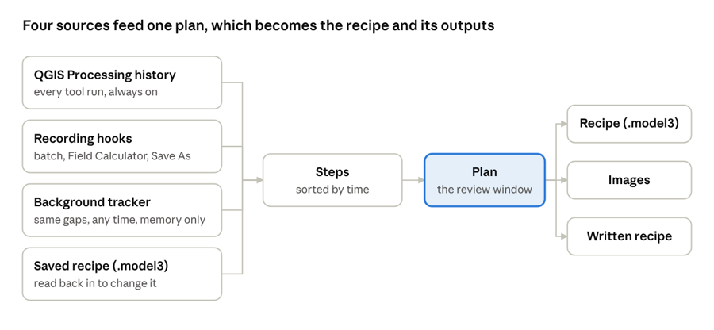

## Where to find it

- The record button on the Sous Chef toolbar

- *Processing › Sous Chef* in the menu bar

- The **Recipe Book** group in the Processing Toolbox, where your saved
  recipes live

- *Create Recipe from This Layer…* when you right-click a layer

## Recording

Until you start recording, the toolbar only shows the record button.
Once you're recording it also shows a step counter, a pause button, a
button to add a note to the step you just ran, a button to look at
what's been recorded so far, and a bin to throw the recording away. Pressing Stop opens the review window. The little arrow
next to the record button lets you go back to earlier recordings from
the same QGIS session.

Pause is there for when you want to try something without it ending up
in the model.

Sous Chef picks up:

- Processing tools, whether you run them from the Toolbox or from a
  Vector/Raster menu item that opens one
- Batch runs and "Iterate over this layer" runs (QGIS doesn't log
  these, so Sous Chef catches them itself)
- The Field Calculator and the quick calculation bar in the attribute
  table. When you save, Sous Chef checks that one of your recent
  expressions actually reproduces the new values; if it does, that
  becomes a step
- Save Features As, when the new file is added to the map
- A selection (by expression, attribute or location) followed by a
  tool run on "selected features only", which becomes an *Extract by…*
  step
- A layer filter (*Filter…* in the Layers panel), which becomes an
  *Extract by expression* step. Filters in a data source's own query
  language may need checking
- A join set up in *Layer Properties › Joins*, which becomes a *Join
  attributes by field value* step
- The Raster Calculator window (Raster menu), which becomes a
  Processing *Raster calculator* step
- A virtual layer, which becomes an *Execute SQL* step (its tables are
  called input1, input2, … there, so check the query)
- A recipe you run while recording: it's unpacked into its own steps,
  so the new recipe doesn't depend on the old one and you can change
  those steps like any others

Anything else you change by hand, like typing values or digitising,
can't be repeated by a model. Sous Chef notes these edits and shows them
in the review so you know they're there.

If you open a different project mid-recording, recording pauses and
tells you.

## Making a recipe from an existing layer

You don't have to record ahead of time. Right-click a layer and choose
*Create Recipe from This Layer…*, and Sous Chef traces back how that
layer was made: the step that produced it, the steps that produced *its*
inputs, and so on, until it reaches layers no step made. Those become
the recipe's inputs. Select several layers first if you want one recipe
that covers them all.

Only the steps that actually lead to the layer are kept, so unrelated
work and abandoned attempts drop out on their own.

This works with anything in QGIS's Processing history. For the things
QGIS doesn't log (Save As, the Field Calculator, batch and iterate runs,
filters, joins, the Raster Calculator and virtual layers), Sous Chef
keeps a small list in memory while QGIS is open. Temporary
layers can only be traced while they're still around; results saved to
files can be traced later too.

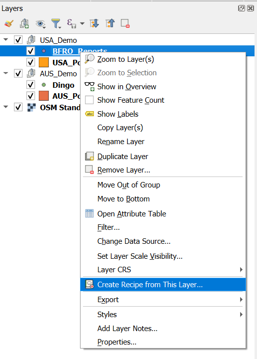

## The review window

This is where you decide what the recipe should look like before saving
it. There are three ways to look at the workflow:

- **Flowchart.** Inputs on the left, results on the right, steps in
  between. You can drag boxes around, pan, zoom, and hit *Tidy* to put
  things back, and click the empty background to clear the selection.
  *Simplified* shows just the steps; *Detailed* lists
  every setting, with the ones you changed from the default first.
  Repeated steps, like a batch or three buffers at different
  distances, are folded into one box ("3 × Buffer (10 / 50 / 100 m)").

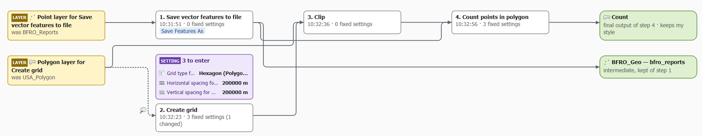

- **List.** A table with a row per step, which is easier going for long
  workflows: a tick box for whether it's in the recipe, the tool, what
  it takes, its settings, what it makes and when it ran, with alternate
  rows shaded. Filters across the top show *All*, *In recipe*, *Left
  out* or *Needs a look*, and anything to check is flagged on the step's
  own row.

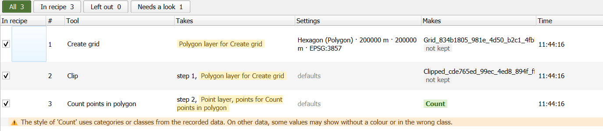

- **Run dialog.** A preview of the window people will see when they run
  the recipe. Switch on *Edit text* to rename things and write help
  text right there; pressing Enter saves what you typed (it doesn't
  close the window).

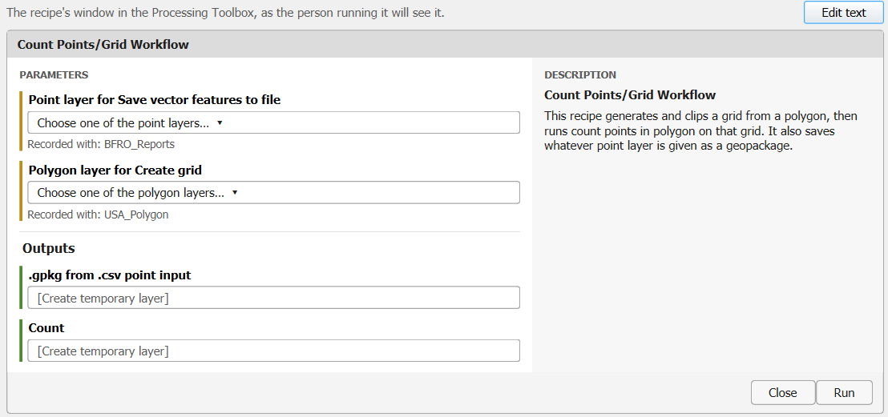

Click anything to see its details in the side panel. For a step, you can
leave it out or decide which settings are fixed and which the recipe
should ask for when it runs. For a result, you can choose whether it's a
final output, an intermediate layer that gets thrown away, or one that's
kept as well, and whether it keeps the style you gave it.

Some steps start out unticked, with the reason shown: exact repeats,
earlier attempts whose results you deleted, results you removed from the
project, plain selections, failed runs, and steps from another project.
Tick any of them back in if Sous Chef guessed wrong. *Left-out
steps* draws them on the flowchart as dashed grey boxes.

**Start from a later step.** Right-click a step (or use the button in
its side panel) and choose *Start the Recipe from This Step's Result*:
that step and the steps leading to it are left out, and its result
becomes a starting layer. Handy when you merged a few layers once and
will start from the merged layer next time. *Undo* brings them back.

Everything is colour coded the same way wherever it appears: input
layers to choose in yellow, steps in white, settings to enter in purple,
and outputs in green. The window follows QGIS's light or dark theme.

Changed your mind? *Undo* (Ctrl+Z) and *Redo* (Ctrl+Shift+Z) take back
any change made in the window. The *?* button opens a short guide to how
Sous Chef works, the tutorial, and *Report a Problem…*

### A few more things you can do

- **Choose columns when the recipe runs.** A tool's column setting, and
  the columns a Field Calculator expression reads, can be set as an
  input. Sous Chef traces each column back to the input layer it came
  from so the person running it can pick from the right list. If it
  can't trace a column (a tool renamed it, say), it stays fixed and
  the side panel says why.

- **Taste test.** Runs the recipe on the layers you recorded with and
  compares the results with what you got the first time (number of
  features and columns; for rasters, size and bands). Nothing gets added to your project.

- **Notes.** Type a note on any step. It's saved as a comment in the
  model, so it shows in the Model Designer too.

- **Symbol.** Give the recipe its own icon in the Recipe Book, picked
  from either a custom set of cooking-related icons or QGIS's SVG
  library. Colours start as a grey fill and a black outline, and *Add
  the recipe card's green gear* (on to start with) puts the recipe
  card's small green gear in the corner, so your recipes stand out in
  the Toolbox. Without a symbol, recipes show the recipe card.

## Images & Animations

*Images & Animations…* in the review window opens one window for
everything you can make from the workflow: pictures and written recipes
of it, not the recipe itself (that's *Add to Recipe Book* and *Share*). A switch at the top chooses **Still image**,
**Animation** or **Recipe**. Under it, a scrolling gallery shows each
design as a small picture made from your own workflow (they fill in a
moment after the window opens). Click one to see it full size in the
preview. Star the ones you use most (*Add to favourites*, or right-click
a picture): favourites move to the front of the gallery.

Animations you preview are kept while the window is open, so you can
click between them and compare. The settings on the right only show what
the chosen design uses, grouped under *What's shown*, *Maps*, *Timing*,
*Look* and *File*; click a heading to open or close it. *Detail* is the
same everywhere: **General** (tools and kinds of data, no layer names
and no real maps: designs made of maps are greyed out, and the others
show the kind of layer instead of its map),
**Named** (your layers and steps) or **Specific** (also the settings you
changed). *Title* sets the title; left empty, it's the recipe's name, or
for a general design a title made from its tools ("Buffer, Clip and
Dissolve workflow").

### Still images

There are a lot of options here, pick what speaks to you.

Thirteen designs: the flowchart as on screen (Boxes), Cards, Minimal, a
Metro map (each starting layer a coloured line, tools its stations),
Swimlanes, Data-centred (a small picture of each layer, drawn in its own
style), Storyboard (a card with a small map of each step's result,
optionally with the starting layers too, above or in a column on the
left that the steps line up with; see *Long workflows* below),
**Summary sheet** (the workflow in numbers: totals, the tools used most,
what it starts from and what it makes), **Radial flowchart** (the recipe
in the middle, its results around it, then the tools, out to the
starting layers), **Feature river** (each layer a band as wide as its
number of features, flowing into the tools and out again), **Sticky
notes** (the steps pinned on a corkboard: ingredients, preparation,
cooking, served), **Comic strip** (storyboard panels with speech bubbles
in kitchen language, in one strip when there are only a few) and
**Pilgrimage** (the finished journey on old paper; the maps at each stop
are optional; a long road makes a wider picture so every stop and
starting layer fits).

Six colour schemes: standard, colour-blind safe, greyscale, dark,
**blueprint** (white on blue squared paper) and **parchment**. *Spacing*
makes a long workflow narrower or roomier. *Page* puts the drawing on a
16:9 slide (the default, ready for a presentation) or keeps its own
shape.

Each design picks a font that suits it from those on your computer
(signage lettering such as Bahnschrift or DIN for the metro map, a book
face such as Palatino for the pilgrimage, and so on), so the look can
differ a little between computers. The Pilgrimage's blackletter title
font and the Comic strip's comic lettering (Bangers) come with Sous
Chef. *Title font* and *Text font* (under *Look*) replace them with any
font you have, for other alphabets (the blackletter font only has Latin
letters) or for taste. Untick *Fonts to match the design* to use your
system's standard font everywhere.

Save as SVG, PNG (on a slide: 1280×720, 1920×1080 or 3840×2160;
otherwise 1×, 2× or 3×; opaque or clear background) or PDF, or *Copy*
the image to paste into a document or slide. Every image carries a small
"Made with Sous Chef" watermark in the corner. I put a lot of work into
this! I want the people to know!

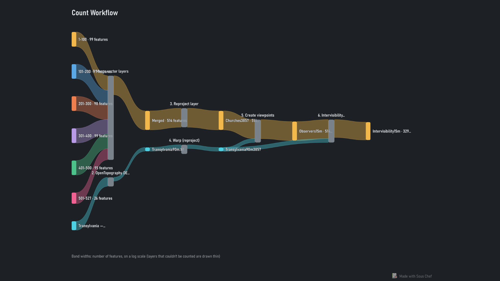

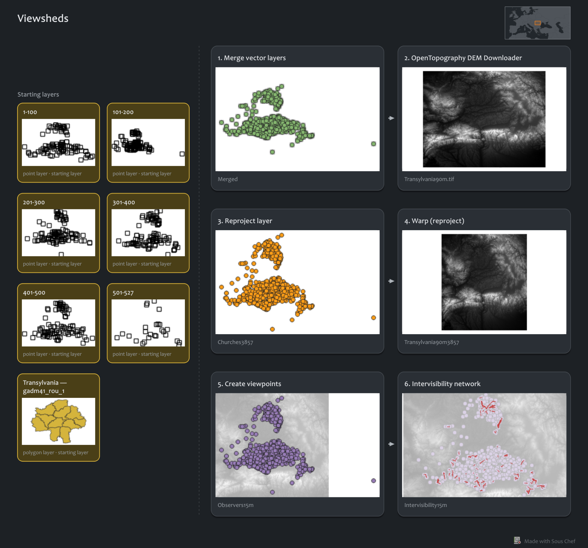 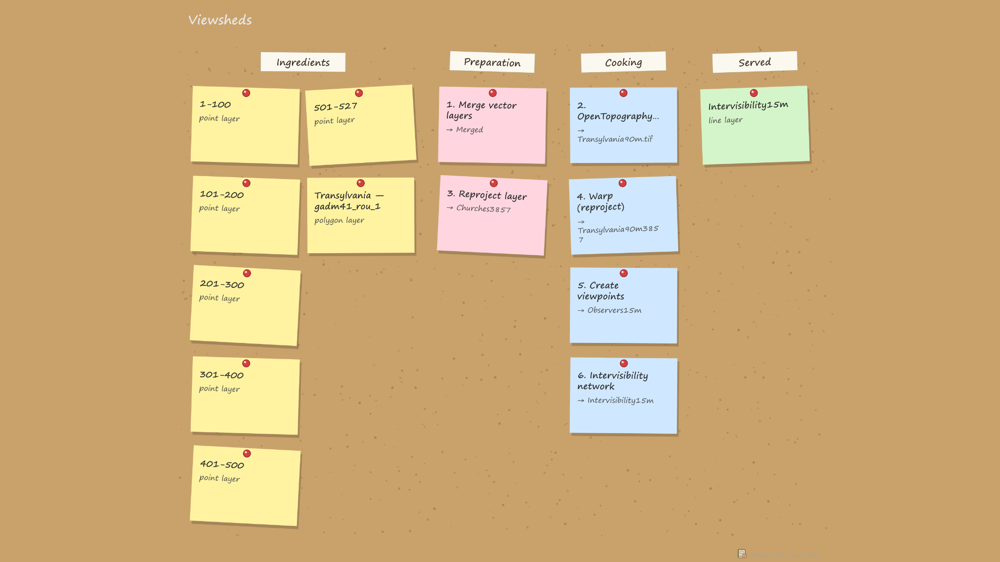 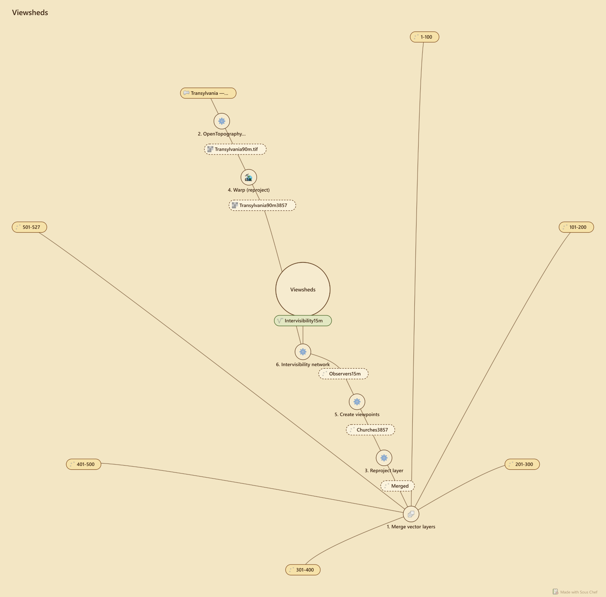 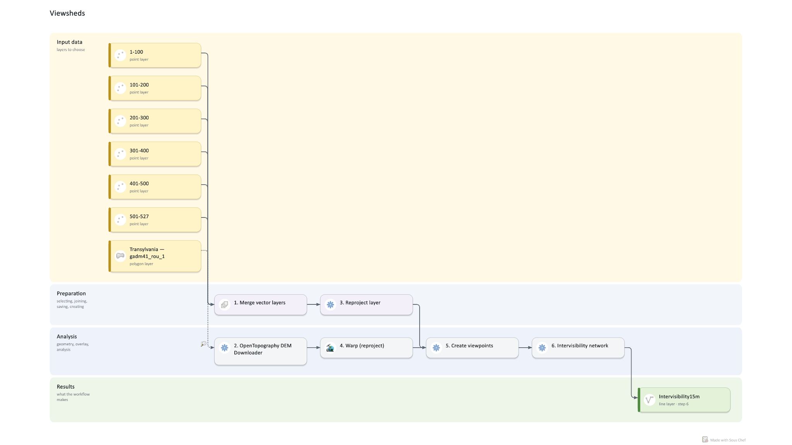 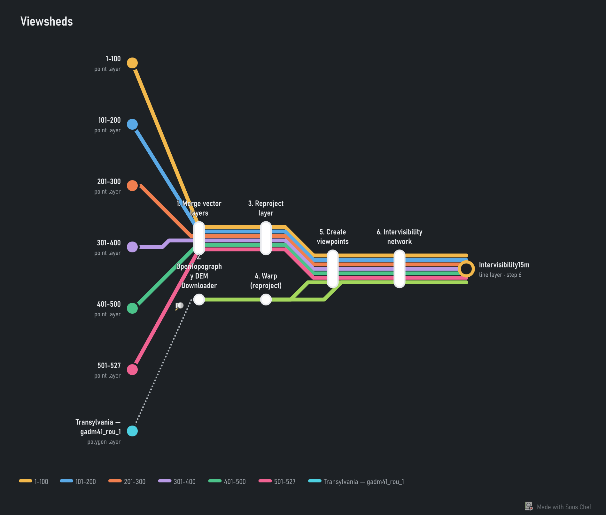 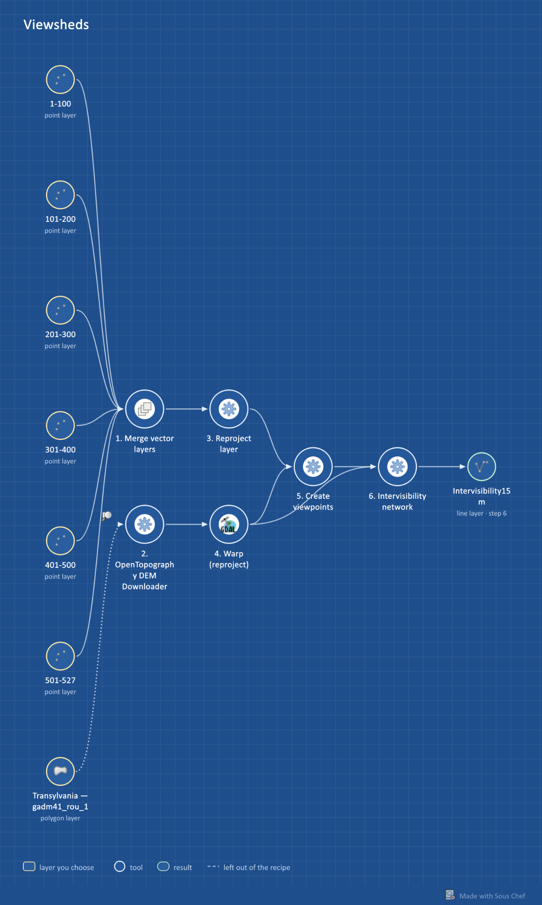

**Long workflows in the Storyboard.** On a slide, the cards run in rows
that wind back and forth, as many to a row as fills the 16:9 page best.
Similar starting layers used together (the six layers a Merge takes,
say) share one stacked card. *Fold small steps* turns housekeeping steps
(reproject, merge, fix geometries and the like) into a short note on the
next card. With *Pages: Split when crowded*, a storyboard of more than 8
cards goes over several pages: one PDF with a page each, or numbered
PNG/SVG files.

### Animations

Animated GIFs or MP4 videos, sixteen kinds, all at standard 16:9 screen
sizes (854×480, 1280×720 or 1920×1080); a bigger size shows the same picture, only sharper. Not all of them work for every
situation, but give them a try and see what you think. Like the image
outputs, these are more intended to show the process than the results.

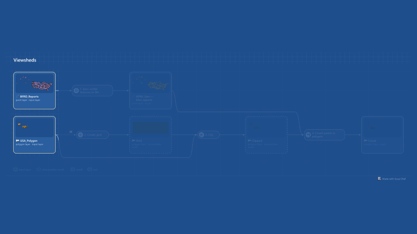

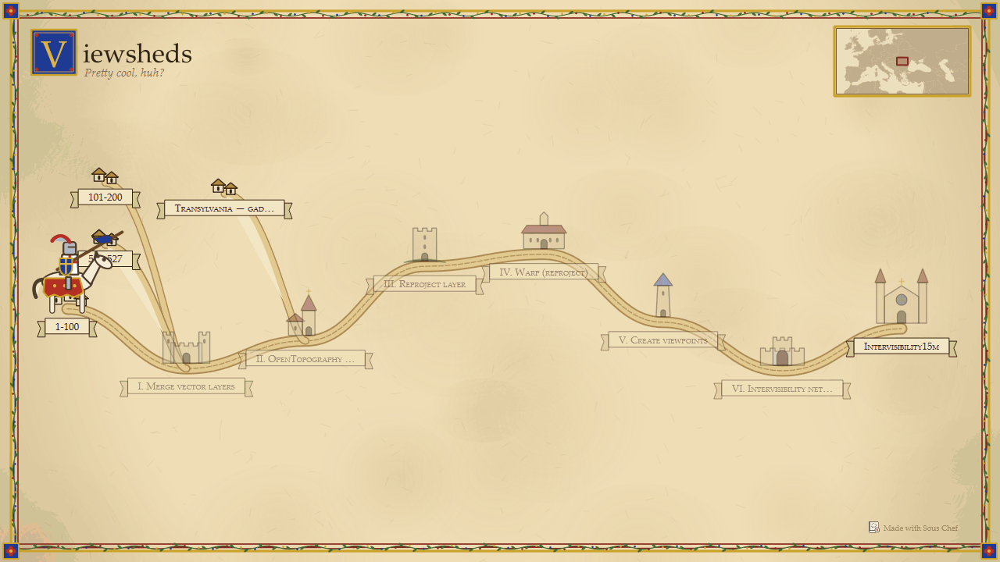

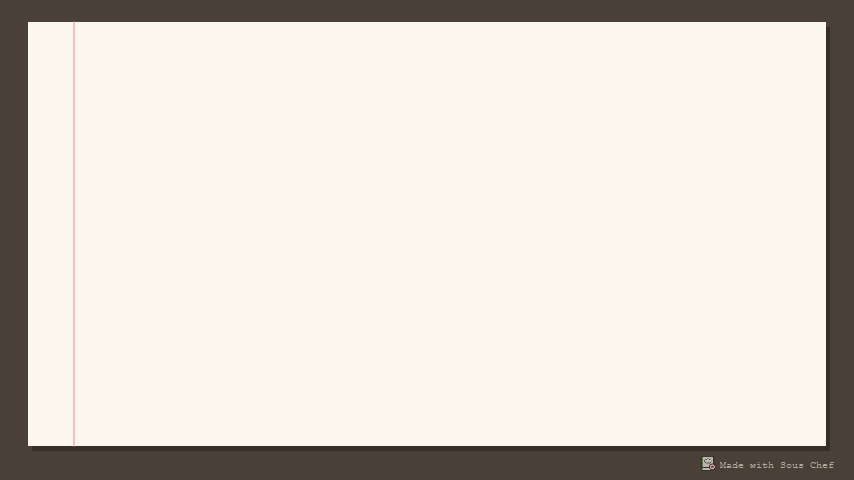

**The ending map.** Animations that end on the result show the recipe's
final outputs, zoomed to them, on the project's visible layers
(faintly). Outputs far apart (in different parts of the world) are shown
side by side, each zoomed to itself and labelled. When there are several
outputs, *Shown at the end* picks one of them instead. In the
Pilgrimage, similar starting layers used together share one hamlet ("6
point layers").

*Speed* (Relaxed ↔ Quick) sets the drawing time, the pauses and the
fades together; *Customise timing* sets each of them, and the frame
rate, separately. Choose to loop or play once, and a size (small for
chat and e-mail, large for slides). Below the preview, an estimate shows
roughly how long the animation runs, how big the file is and how many
frames it has. *▶ Preview* makes a small version and plays it in the
window. *Save Frames…* saves every frame as a numbered PNG with their
timings, for making a video in another program. Note that the preview
can squish the GIF - it may appear to have overlaps and such in the
preview, but they won’t be there in the final version.

**GIF or MP4.** *Save as* chooses the file type. A GIF plays anywhere
but has only 256 colours, so photo-like basemaps look grainy (plain maps
look fine). An MP4 video has every colour and is usually a much smaller
file, which suits slides and the web. MP4 needs
[ffmpeg](https://ffmpeg.org/download.html), a free program: Sous
Chef uses it if it's installed (on the PATH, in QGIS's own folder, or in
the usual places), or you can say where it is on Sous Chef's page in
*Settings › Options*. Without it, GIF and *Save Frames…* still work.

### Recipes

- **Cookbook recipe.** A fun recipe card (PDF): a word-art title
  ("Grandma's Famous Count Points in Polygon") in one of eight looks, a
  serving size, a prep time and a method in kitchen language ("Fold a 50
  m border around the roads"). *Reshuffle* picks new phrasings, a new
  adjective and a new title look.
- **Written recipe.** Plain instructions: what it makes, the
  ingredients (the layers to choose and the settings to enter) and the
  method as numbered steps. PDF, web page, Markdown or text.
- **Methods paragraph.** The workflow written as a paragraph for the
  methods section of a report or paper: the QGIS version, the coordinate
  system, the starting layers, each tool with the settings that matter,
  and the results. Text or Markdown, or *Copy Text* to paste it straight
  in.
- **Checklist.** Tick boxes for doing or checking the workflow by
  hand: what to have ready, each step, and the results to check. PDF,
  Markdown or text.

### Overview map and separate parts

*Overview map* (under *Maps*) adds a small, plain world map with a box
where the layers are (a marker when the area is too small to see as a
box). *Region* zooms it to the part of the world around them instead of
the whole globe (it's not offered with General detail, which shows no
real places). The map animations show it in a corner of each frame;
the Storyboard, the Pilgrimage and the recipes show it once, by the
title, rather than on every small map.

When the steps form separate parts that don't use each other's results
(say a grid count in one place and a viewshed somewhere else), *Parts*
lets you export **all** of them or just **one**. With all, the map
animations zoom to each part in turn, with a "Part 2 of 2" caption as
each part begins, and the overview map highlights the part being shown;
written recipes and the checklist get a heading for each part, and the
methods paragraph a paragraph for each.

The cookbook and written recipes can show a **small map of each step**
(tick *Map of each step*). The maps are drawn from the layers in your
project. If a step's result is gone (a temporary layer you removed,
say), Sous Chef runs the recipe again on its starting layers to draw it,
which can take a moment. *Background layers (basemaps)* also draws your project's
visible basemaps behind them; online basemaps need an internet
connection.

## Saving and sharing

*Add to Recipe Book* saves the recipe and leaves the window open so you
can keep adjusting it; *Add and Close* does what it says. Leave *Group*
empty to put the recipe straight into the Recipe Book, or type a name to
file it in a sub-group.

If you save over an existing recipe, the old version is kept as
<name>.model3.bak. Rename it back to .model3 to undo.

You can open a saved recipe again later to rename things, change what's
asked, or leave steps out: use *Open a Recipe to Review or Tweak…*, or
right-click it in the Recipe Book. The right-click menu also lets you
open it in the Model Designer, show it in its folder, or delete it.
Recipes that use features Sous Chef can't rebuild (conditional branches,
expressions as inputs, a missing tool) open view-only, and you can edit
those in the Model Designer instead.

Recipes are stored in <QGIS profile>/sous_chef/models. The easiest way
to share one is *Share › Share as One Zip File…* in the review window
(or *Share as Zip…* when you right-click it in the Recipe Book): the zip
holds the recipe, its styles and its symbol. The other person unzips it
and adds the .model3 file with *Processing Toolbox › Models › Add Model
to Toolbox*; they don't need Sous Chef. If the recipe uses tools from
other plugins, its description lists them.

*Save as Python Script…* (in the same places) writes the recipe as a
Processing script, for people who'd rather read or change it as code.

## What Sous Chef keeps, and what it doesn't

While QGIS is open, a background tracker notes Save As, Field
Calculator, batch and iterate runs, filters, joins, the Raster
Calculator and virtual layers so that *Create Recipe from This
Layer…* can find them later. It only keeps the last 500 of each, only in
memory, and it's gone when you close QGIS. You can turn it off under
*Processing › Sous Chef › Background Tracking*, or on Sous Chef's page
in *Settings › Options*, which also shows where recipes are kept, sets
the folder for images and shared files, and where ffmpeg is (for MP4
videos).

*Clear Sous Chef's Temporary Data…* in the same menu forgets everything
the tracker noted and cleans up leftover taste-test files. Sous Chef
also tidies those up each time QGIS starts.

Your recipes, their styles and backups, and the images you save are
never touched.

## Help and problems

The first time Sous Chef starts, a short tutorial shows how it's used;
it's under *How Sous Chef Works… › Tutorial…* any time. If something
goes wrong, *Report a Problem…* (in *Processing › Sous Chef*, under the
review window's *?*, and next to Sous Chef's error messages) makes a
short report with the versions and the last error, for you to read and
change before sending it as a GitHub issue or copying it. No layers or
data go into it. Problems Sous Chef works around by itself are noted in
QGIS's *Log Messages* panel, on the *Sous Chef* tab.

## Limitations

- Hand edits (typed values, digitising, deleting features) can't be
  repeated. You can have the recipe ask for the edited layer instead.
- If a Field Calculator expression uses the field it's changing, Sous
  Chef can't check it against the data and just trusts the most recent
  expression.
- Selections made by clicking on the map can't be repeated.
- Styles based on categories or classes use the values from your
  recording.
- A model can't pick a fresh file name each time it runs, so running
  it again overwrites the same output file unless you change the name.
  On Windows that fails if the file is open in QGIS.
- QGIS only logs Processing runs to the second, so two things done
  within the same second might come out in the wrong order.
- Catching batch and iterate runs relies on QGIS internals. If a
  future QGIS version changes those, those runs will stop being picked
  up (layers that appear without a step are flagged in the review, so
  you'll notice).
- Recipes that use tools from other plugins only run where those
  plugins are installed.

**Does it slow QGIS down?** Not noticeably. Outside recording, the
tracker only wakes up for the kinds of action it watches. The biggest
cost is checking Field Calculator expressions on very large layers when
you save.

## Disclaimer

AI was used in the creation of this plugin, but that doesn't mean it hasn't 
been rigorously tested. Public version 1 is actually version 64.

## Licence

GPL-3.0-or-later. See `sous_chef/LICENSE`. The bundled fonts
(blackletter and comic lettering) are under the SIL Open Font License;
see `sous_chef/fonts/README.txt`.
